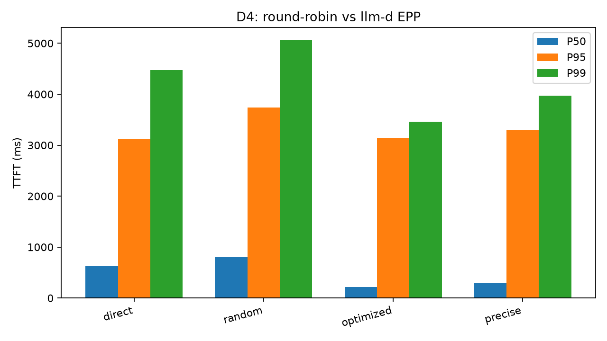
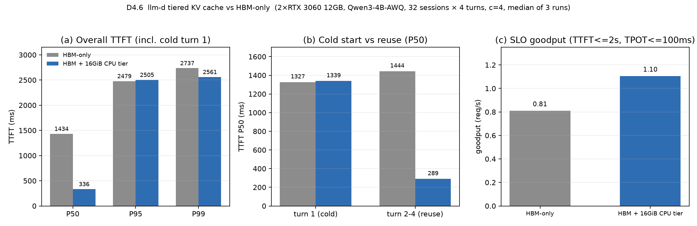

# LLM Inference Platform Lab

`echo 我要测：TTFT P50/P95/P99、output tok/s、GPU util、$/1M tokens`

D1：单卡 L4 上的 vLLM serving 基线。执行步骤见 [`d1-vllm-baseline-runbook.md`](./d1-vllm-baseline-runbook.md)；D2 调参见 [`d2-vllm-tuning-runbook.md`](./d2-vllm-tuning-runbook.md)。

## 环境

- **GPU**：NVIDIA L4 24GB（23,034 MiB），**40W power cap**（`SW Power Cap Active`；不是默认 72W）
- **平台**：Vast.ai on-demand，实例 `61674313`，`$0.2611/h`
- **镜像**：`vllm/vllm-openai:v0.34.0`（镜像内 CUDA 13.0.2）
- **host**：driver 595.99.02（Max CUDA 13.2），24 vCPU / 125GB RAM
- **模型**：`Qwen/Qwen3-8B-AWQ`（约 5.7GB）
- **服务**：`max-model-len 8192`、`gpu-memory-utilization 0.90`、`max-num-seqs 64`、prefix caching 默认开
- **启动指标**：模型加载约 **69s**；KV cache **96,256 tokens**；8k 请求最大并发 **11.75x**
- **负载**：`vllm bench serve` → `/v1/completions`，random 数据集，输入 1024 / 输出 256，`--ignore-eos`，`--temperature 0`
- **采样**：`nvidia-smi` 每秒一次（util / 显存 / 功耗 / 温度 / SM clock）+ vLLM `/metrics` 抢占计数

## D1 baseline（2026-11-20）

c=16 / c=64 各跑两轮，表中为两轮中位数，括号内为范围；c=1 / c=4 单轮。

| 并发 c | n | 轮次 | TTFT P50 (ms) | TTFT P95 (ms) | TTFT P99 (ms) | 服务端排队 P99 (ms) | TPOT P95 (ms) | output tok/s | goodput (req/s) | GPU util mean/P95 | 抢占 Δ |
|---|---|---|---|---|---|---|---|---|---|---|---|
| 1 | 100 | 1 | 1,038 | 1,053 | 1,057 | n/a | 47.4 | 19.6 | 0.077 | 99.8% / 100% | 0 |
| 4 | 200 | 1 | 2,914 | 3,066 | 3,839 | n/a | 63.2 | 59.3 | 0.058 | 99.9% / 100% | 0 |
| 16 | 500 | 2 | 3,217 (3,212–3,222) | 7,459 (7,026–7,893) | 11,715 (10,917–12,514) | 9,051¹ | 135.7 (134.4–137.0) | 112.5 (111.9–113.0) | 0.0009 | 100% / 100% | 0 |
| 64 | 1,000 | 2 | 7,036 (7,033–7,040) | 14,551 (14,541–14,561) | 55,474 (55,454–55,495) | n/a | 469.9 (469.7–470.1) | 132.8 (132.7–132.8) | 0 | 100% / 100% | 0 |

¹ 来自单独的诊断跑：c=16、n=200、服务端开 `--enable-per-request-metrics`。`server_queue_times` 单位是秒，已换算成 ms。baseline 的四个 JSON 没有这个字段，其余点写 `n/a`。

重复性：c=64 两轮几乎完全一致（吞吐差 0.1%）；c=16 吞吐/TPOT 稳定，TTFT P99 有约 13% 的尾部波动。

## 诊断：排队 vs prefill

诊断跑（c=16、n=200、同一台 40W L4）：

| 指标 | P50 | P95 | P99 |
|---|---|---|---|
| 客户端 TTFT | 4,559 ms | 7,877 ms | 13,507 ms |
| 服务端调度排队 `server_queue_times` | ~0 ms | 2,504 ms | 9,051 ms |
| 服务端首 token `server_ttfts` | 3,038 ms | 5,788 ms | 5,911 ms |
| 同一请求 `排队 + 首 token` | 3,045 ms | 6,171 ms | 12,738 ms |
| 差额（前端/网络/tokenization） | 1,057 ms | 1,959 ms | 1,982 ms |

- 排队是双峰的：约 90% 请求排队几乎为 0，约 10% 排队数秒，P99 到 9.05s；
- 服务端首 token 在 c=16 下 P50 已到 3.0s（c=1 时客户端 TTFT 才 1.0s），说明 chunked prefill 与 decode 争抢后，prefill 被拉长；
- 同一请求相加后的 P99 是 12.74s，客户端 TTFT P99 13.51s，差约 0.8s 是 API 前端/网络开销。
- decode 也不是匀速：展平 `itls` 后 P50 80ms、P99 1.83s、P99.9 1.99s，但 per-request TPOT P95 只有 133.5ms——每条请求的 255 个 gap 里中位数有 8 个超过 1s，被平均掉了。所以“TPOT 达标”不等于“没有卡顿”。
- 停顿不是抢占（计数为 0），更像 prefill 调度步长：一个 iteration 塞进大块 prefill 时，decode 要等这一大步算完。D2 用 `--max-num-batched-tokens 512` 直接压小步长；`--disable-chunked-prefill` 只有在固定 2048 预算下才可比（默认会自动把预算抬到 8192，见 D2 runbook §4.3）。

## 一句话结论

在这台 **40W 限功耗**的 L4 上，c=1→16 时 output throughput 从 19.6 升到 112.5 tok/s（×5.7），但 TTFT P99 从 1.06s 升到 11.7s（×11）、TPOT P95 从 47ms 升到 136ms（×2.9）；c=16→64 吞吐只再 +18%，TPOT P95 到 470ms、TTFT P99 到 55.5s、goodput 归零。诊断跑显示 c=16 的尾部主要是**调度排队（P99 9.05s）**加**服务端首 token（P99 5.91s）**，decode TPOT P95 133.5ms，四轮抢占均为 0。因此瓶颈是 **40W 功耗墙下的 batching/排队**，不是 KV cache 不足；这台卡不能直接和公开的 72W L4 数字对比。

## 成本

| 实验 | 实例 | 运行时长 | Vast Charges | 说明 |
|---|---|---|---|---|
| D1 | `61674313` | 约 3.9h | **$1.03** | GPU + 40GB 存储，2026-11-20 |
| D2 | `62184627` | 约 4.9h | **$1.29**（约 $1.2） | GPU + 40GB 存储，2026-11-23；含 FP16 下载 |
| D3 | `62375081`（含前期重建） | 约 4h | **$4.00** | 2×RTX 4090 VM + 130GB 存储；含 KEDA、HTTP Add-on、驱逐实验 |
| D4 | `62540497` | 约 4.5h | **$1.19** | 2×RTX 3060 12GB VM + 130GB 存储，2026-11-25 |

GPU `$0.25/h` + 40GB 存储 `$0.0111/h` = **`$0.2611/h`**；FP16 下载是 ingress，未产生额外带宽费。D2 后 Vast 账户余额 **$18.81**；D3 实付 **$4.00**，D1 + D2 + D3 合计约 **$6.32**，余额约 **$14.81**。

D1/D2 已 **Destroy**；D3 实例 `62375081` 也已于 2026-11-24 **Destroy**，D3 实付 **`$4.00`**（最终账单以 Vast 为准）。D4 实付 **`$1.19`**；D1 + D2 + D3 + D4 合计约 **`$7.51`**，余额约 **`$13.74`**。

## 复现

1. 按 `d1-vllm-baseline-runbook.md` 租同规格 on-demand L4，记录 `power.limit`；
2. 用 `vllm/vllm-openai:v0.34.0` 和 `Qwen/Qwen3-8B-AWQ` 起服务；
3. 跑 c=1/4/16/64，结果写 `results/`；
4. 需要拆排队时，用 §6 的诊断跑；
5. 重复 c=16/64 时按 §5.4，报中位数/范围。

## D2 结果（2026-11-23）

### 4.1 控制组

同一天、同一台 40W L4、AWQ、`max-model-len 8192`、`max-num-seqs 64`，KV 91,648，三组抢占均为 0：

| c | n | output tok/s | TTFT P50 | TTFT P99 | TPOT P95 | ITL P99.9 | >1s gaps/req | goodput |
|---|---|---|---|---|---|---|---|---|
| 8 | 100 | 90.4 | 2.78s | 6.84s | 83.0ms | 1,760ms | 0 | 0.0883（25%） |
| 16 | 200 | 119.8 | 4.07s | 12.10s | 126.4ms | 1,810ms | 3 | 0.0023（0.5%） |
| 64 | 300 | 143.1 | 8.10s | 57.71s | 426.2ms | 2,172ms | 31 | 0 |

c=16 是延迟基准，c=64 是吞吐基准；c=8 是 4.5 的同并发对照，也是 D2 里唯一 goodput 非零的 AWQ 点。c=64 比 D1 的 132.8 tok/s 高 7.8%，主要因为 n=300 比 D1 的 n=1000 短、热节流更少。完整表与归因见 `d2-vllm-tuning-runbook.md` §4.1.1。

### 4.2 max-num-seqs

同一天、同一台 40W L4、AWQ、c=64、n=300：

| `max-num-seqs` | output tok/s | TTFT P50 | TPOT P95 | goodput |
|---|---|---|---|---|
| 64（控制） | 143.1 | 8.1s | 426ms | 0 |
| 32 | 137.5 | 63.3s | 226ms | 0 |
| 16 | 119.8 | 104.9s | 130ms | 0 |

降 `max-num-seqs` 显著改善 TPOT（426→130ms），但 TTFT P50 从 8.1s 涨到 105s；`mns16` 的吞吐/TPOT 与 c=16 控制组几乎相同，说明**客户端并发超过服务端上限只增加排队，不增加吞吐**。完整表与归因见 `d2-vllm-tuning-runbook.md` §4.2.1。

> D2 的 n=300，D1 的 n=1000；控制组吞吐比 D1 高 7.8%，主要来自运行时长/热节流差异。只做同一天、同一 n 的对比。

### 4.3 chunked prefill off（固定 2048 预算）

同一天、同一台 40W L4、AWQ、c=16、n=200：

| run | output tok/s | TTFT P50 | TTFT P99 | TPOT P95 | ITL P99.9 | >1s gaps/req |
|---|---|---|---|---|---|---|
| control-2k（chunk on） | 119.4 | 4.15s | 12.32s | 126.6ms | 1,811ms | 3 |
| chunk-off | 120.4 | 2.76s | 11.47s | 125.6ms | 993ms | 0 |

`--disable-chunked-prefill` 同时降低 ITL 尾部和 TTFT，吞吐/TPOT 基本不变；200 条请求里 **0 条**出现 `>1s gap`。这是 c=16、1024-token prompt 的结果，不能外推到高并发/长 prompt。完整表与归因见 `d2-vllm-tuning-runbook.md` §4.3.1。

### 4.3b max-num-batched-tokens 512

| run | output tok/s | TTFT P50 | TTFT P99 | TPOT P95 | ITL P99.9 | >1s gaps/req |
|---|---|---|---|---|---|---|
| control-2k（budget 2048） | 119.4 | 4.15s | 12.32s | 126.6ms | 1,811ms | 3 |
| chunk-off（budget 2048，off） | 120.4 | 2.76s | 11.47s | 125.6ms | 993ms | 0 |
| bt512（budget 512） | 118.3 | 2.50s | 12.78s | 127.3ms | 566ms | 0 |

`bt512` 验证了“prefill 步长”假设：ITL P99.9 从 1,811ms 降到 566ms，200 条请求里 0 条出现 `>1s gap`；代价是 TTFT P99 12.32→12.78s、吞吐 −0.9%。`chunk-off` 更均衡，`bt512` 是更激进的 ITL 尾部修复。完整表与归因见 `d2-vllm-tuning-runbook.md` §4.3b.1。

### 4.4 prefix caching（共享 512-token 前缀）

| run | output tok/s | TTFT P50 | TTFT P99 | TPOT P95 | ITL P99.9 | goodput | 命中率 |
|---|---|---|---|---|---|---|---|
| prefix-off | 120.0 | 4.17s | 12.45s | 126.2ms | 1,776ms | 0.0023（0.5%） | 0% |
| prefix-on | 149.9 | 4.00s | 7.11s | 101.8ms | 1,689ms | 0.1084（18.5%） | ~50% |

`prefix-on` 命中率 ~50%（512/1024），output +24.9%，TTFT P99 −42.9%，TPOT P95 −19.3%，goodput 0.5%→18.5%。prefix caching 不只是 TTFT 优化：它减少 prefill 与 decode 的竞争，所以吞吐/TPOT 也改善。完整表与归因见 `d2-vllm-tuning-runbook.md` §4.4.1。

### 4.5 AWQ vs FP16

| run | output tok/s | TTFT P50 | TPOT P95 | goodput | 抢占 | KV |
|---|---|---|---|---|---|---|
| AWQ c8 | 90.4 | 2.78s | 83.0ms | 0.0883（25%） | 0 | 91,648 |
| FP16 c8 | 57.2 | 3.17s | 133.3ms | 0 | 0 | 18,944 |
| FP16 c16（KV 受限） | 77.0 | 4.83s | 240.1ms | 0 | **26** | 18,944 |

c=8 是纯量化对比：FP16 比 AWQ 慢 **36.8%**，TPOT P95 高 **60.6%**，goodput 25%→0。c=16 需要 20,480 > 18,944，实测抢占 **26 次**，是 KV 受限的混合效应，不能当纯量化。质量掉点见 §5 的 GSM8K 质量门。完整表与归因见 `d2-vllm-tuning-runbook.md` §4.5.2。

### 5. 质量门（GSM8K 50）

| 模型 | 原始命中 | strict-match | flexible-extract |
|---|---|---|---|
| AWQ | 46/50 | 0.92 | 0.92 |
| FP16 | 45/50 | 0.90 | 0.90 |

差 1 道题（2 个百分点），在 n=50 的噪声内（单个比例 95% CI 约 ±8 点）；**未检测到 AWQ 明显掉点**。结合 4.5：AWQ 在 c=8 快 36.8%、TPOT P95 好 60.6%，是当前 24GB L4 更优的默认配置。50 条只是 smoke test，不能外推到其他任务。

## D4 结果（2026-11-25）

llm-d precise prefix-cache routing：2×RTX 3060 12GB、Qwen3-4B-AWQ、2 副本 TP=1、128 条共享前缀请求（32 session × 4 turn，c=16）。完整 setup、失败记录和成本见 [`results/d4/summary.md`](./results/d4/summary.md)，执行步骤见 [`d4-llm-d-learning.md`](./d4-llm-d-learning.md) §5。

| arm | n | TTFT P50 | TTFT P95 | TTFT P99 | TPOT P50 | output tok/s | goodput |
|---|---|---|---|---|---|---|---|
| direct（Service 基线） | 3 | 628 ms | 3114 ms | 4475 ms | 27.6 ms | 424 | 0.914 |
| random（EPP 控制组） | 1 | 798 ms | 3739 ms | 5056 ms | 26.1 ms | 438 | 0.844 |
| **optimized（approx）** | 3 | **216 ms** | **3140 ms** | **3459 ms** | **20.8 ms** | **570** | **0.906** |
| precise（KV 事件） | 3 | 298 ms | 3292 ms | 3969 ms | 20.9 ms | 558 | 0.875 |

**归因（P99）**：direct → random **+581 ms**（Envoy+EPP 代理税）；random → optimized **−1597 ms**（近似前缀亲和）；optimized → precise **+510 ms**（render 平均 42 ms/请求 + 精确索引开销）。optimized 比 direct 低 **22.7%**；precise 没有赢过 optimized。

**结论**：2 副本、1.5k 长前缀、无驱逐压力时，approx 索引已经够用；precise 的额外准确性用不上，42 ms/请求的 render 成本是实打实的。precise 的价值边界是更多副本、频繁驱逐、旁路 EPP 的请求比例。

**成本**：Vast 计费 4.54h × `$0.26148/h` ≈ **$1.19**。

## D4.6 结果（2026-11-25）

llm-d tiered KV cache：2×RTX 3060 12GB、Qwen3-4B-AWQ、2 副本、每副本 **16GiB CPU tier**（vLLM `OffloadingConnector`）、32 session × 4 turn、c=4。完整 setup、失败记录和成本见 [`results/d4.6/summary.md`](./results/d4.6/summary.md)，执行步骤见 [`d4.6-tiered-cache-lab.md`](./d4.6-tiered-cache-lab.md)。

| arm | n | TTFT P50 | TTFT P95 | TTFT P99 | TPOT P95 | output tok/s | goodput |
|---|---|---|---|---|---|---|---|
| HBM-only | 3 | 1434 ms | 2479 ms | 2737 ms | 36.7 ms | 115.3 | 0.810 |
| **HBM + 16GiB CPU tier** | 3 | **336 ms** | 2505 ms | 2561 ms | **25.9 ms** | **161.5** | **1.105** |
| 变化 | — | **−76.6%** | +1.0% | −6.4% | −29.4% | **+40.0%** | **+36.4%** |

**归因**：tiered 的复用请求（turn 2–4）P50 从 **1444ms 降到 289ms（−80%）**；每轮 store 28GiB / load 31GiB，CPU hit 51–53%，preemption 0。但 25% 的请求是 turn 1 冷启动，整体 P95/P99 由冷 prefill 决定，所以 tiered **不是 P99 银弹**——它是吞吐/中位数优化（goodput +36%）。

**方法学坑**：`/reset_prefix_cache` 默认 `reset_external=false`，只清 HBM、不清 CPU tier；第一次 tiered 三轮因 warm-cache 污染，CPU hit 从 59%→95%、P99 假性降到 1.4s。改成 `?reset_external=true` 重跑后，CPU hit 稳定在 51–53%。详见 D4.6 文档 §7.7。

**成本**：D4.6 增量 ~1.1h × `$0.2615/h` ≈ **$0.29**；实例累计 ~6.3h ≈ **$1.66**（含 D4 收尾）。

## 下一步

D2 的参数对比、概念问答（chunked prefill / batched tokens / prefix caching / AWQ）和执行步骤见 `d2-vllm-tuning-runbook.md`。

D3（k3s + vLLM Deployment、冷启动、KEDA、驱逐）的学习文档见 [`d3-k8s-vllm-learning.md`](./d3-k8s-vllm-learning.md)（2026-11-24 已执行；§7 冷启动、§8 KEDA/1→2、§9 驱逐均有实测；VM 已 Destroy）。

D4（llm-d 路由）的学习文档见 [`d4-llm-d-learning.md`](./d4-llm-d-learning.md)（**2026-11-25 已执行**；2×RTX 3060 12GB、Qwen3-4B-AWQ、llm-d 1.0 precise routing；`peakPrefillThroughput=2657`；结果见上表与 `results/d4/`；§1.4 + 附录 A 覆盖 llm-d 核心 feature，脚本见 `scripts/d4/`；缩写全称见该文 §1.0.1）。

D4.5（可选，Q2）：PD 分离 2P+2D，4×4090 VM（4×L4 VM 不可得）；**本次 instance 62540497 是 2×3060 12GB，只有 2 卡，不能 2P+2D；4×3060 VM 不存在，D4.5 标记 skipped/blocked**；4×4090 5h（约 $9.3）保留为可选；见 [`d4.5-pd-lab.md`](./d4.5-pd-lab.md)（本次不执行）。

D4.6（可选，T1-C）：tiered KV cache，**2×3060 12GB + Qwen3-4B-AWQ，16GiB CPU tier，3+3 轮**；**2026-11-25 已执行**，P50 1434→336ms（−77%）、goodput 0.81→1.10 req/s（+36%）、整体 P99 不变（冷启动主导）；见 [`d4.6-tiered-cache-lab.md`](./d4.6-tiered-cache-lab.md) 与 `results/d4.6/`。

D5（B 线，3h）：Kueue 两团队 GPU 配额 + Kyverno CEL 准入；**2026-11-26 按单卡 VM 重写，尚未在 Vast 执行**；单卡核心证据是 team B 的 Workload `Admitted` + Pod `Pending`，证明 quota 与 capacity 分离；本地 kind 已用假 `nvidia.com/gpu=2` 验证配额/排队/抢占和 CEL 策略（只验证机制）；文档见 [`d5-kueue-kyverno-lab.md`](./d5-kueue-kyverno-lab.md)，manifest 在 `scripts/d5/`；Kueue `v0.20.7`、Kyverno `1.20.0`，旧 `ClusterPolicy` 在 1.20 已停止执行。

D6（B 线，5–6h，两段）：**D6a KServe 服务抽象（3h）+ D6b 推理可观测性（2–3h）**，合并了原 D6/D7；**2026-11-26 准备，尚未在 Vast 执行**；同一模型 raw Deployment vs KServe `InferenceService`，加 DCGM/vLLM/OTel/Grafana/告警/game day，不重跑 D4；文档见 [`d6-kserve-observability.md`](./d6-kserve-observability.md)，manifest 在 `scripts/d6/`；KServe `v0.21.0`、vLLM `v0.34.0`、Qwen3-8B-AWQ；Standard mode 不支持 HTTP scale-to-zero。

技术栈调研与 D1–D6 缺口见 [`market-stack-gap-analysis.md`](./market-stack-gap-analysis.md)（2026-11-24；2026-11-26 合并 D6）：A 线缺 SGLang/TP/DCGM+OTel，B 线缺 KServe/GPU Operator/安全/OpenCost（Argo CD 由日常工作覆盖）；按 P0/P1/P2 排了最小实验，补法不改变 D1–D5 主线，D6 为 B 线加挂。
