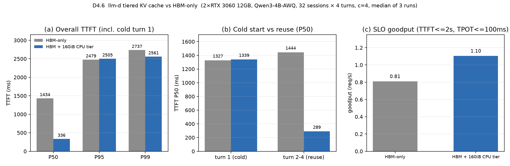

# D4.6 学习文档：llm-d Tiered KV Cache（2×RTX 3060 12GB + Qwen3-4B-AWQ）

> 状态：**executed（2026-11-25）**。2×RTX 3060 12GB VM（instance `62540497`）、2 个 vLLM 副本、每副本 16GiB CPU tier、HBM-only / tiered 各 3 轮、并发 c=4。全部 128 请求/轮，`errors=0`，`num_preemptions_total=0`。
>
> 计划位置：D4 之后（D4.5 本次 skipped/blocked）；Q2 的“Agentic / 长上下文”artifact。它不是 D4 的 4h 主实验。
>
> 性质：**单机 KV 分层对比实验**，不是路由实验。主问题是：同样 2×3060、同一个 Qwen3-4B-AWQ（Activation-aware Weight Quantization，激活感知权重量化），**HBM-only（High Bandwidth Memory，高带宽显存）** vs **HBM + 16GiB CPU tier**，在长共享前缀、会触发 HBM 驱逐的 workload 下，TTFT（Time to First Token，首 token 延迟）P99（第 99 百分位）和 goodput 谁更好。
>
> 硬约束：不在 `uat-mobility-aks-01` 上跑；Vast on-demand 2×3060 12GB VM；同机、同模型、同输入/输出、同 SLO（Service Level Objective，服务等级目标）；先完成 D4。

---

## 0. 先看结论

### 0.1 一句话

> 在 2×3060 12GB / 16GiB CPU tier / 3.6k-token 前缀 / 32 sessions 下，tiered KV **值得做吞吐和中位数优化**（TTFT P50 −77%，goodput +36%），但**不是 P99 银弹**；它的收益边界是“工作集能放进 HBM+CPU，且请求有复用”，冷启动 tail 需要 warmup、请求隔离或更大的 tier。

### 0.2 关键数字（3 轮中位数）

| 指标 | HBM-only | tiered | 变化 |
|---|---:|---:|---:|
| TTFT P50 | 1434ms | **336ms** | **−76.6%** |
| TTFT P95 | 2479ms | 2505ms | +1.0% |
| TTFT P99 | 2737ms | 2561ms | −6.4% |
| TPOT P95 | 36.7ms | 25.9ms | −29.4% |
| goodput（TTFT≤2s + TPOT≤100ms） | 0.810 req/s | **1.105 req/s** | **+36.4%** |
| output tok/s | 115.3 | **161.5** | **+40.0%** |
| wall time（128 请求） | 142.1s | **101.5s** | **−28.6%** |
| SLO 达标率 | 89.8% | 88.3% | −1.7%（噪声内） |

**冷/热拆分：**

| arm | turn 1（冷）P50 | turn 2–4（复用）P50 |
|---|---:|---:|
| hbm | 1327ms | 1444ms |
| tiered | 1339ms | **289ms** |

复用请求 P50 **−80.0%**；冷启动不变。整体 P95/P99 由 25% 的冷 turn 1 决定，所以 tiered 的整体 P99 不会明显变好。

### 0.3 机制证据

| 指标 | 实测（每轮，两副本求和） |
|---|---|
| `vllm:kv_offload_store_bytes_total` | 27.77–28.71GiB |
| `vllm:kv_offload_load_bytes_total` | 30.77–32.62GiB |
| `vllm:external_prefix_cache_hits_total / queries_total` | 51.2–53.1% |
| HBM 命中率 | 4.6–6.6%（HBM-only 5.8–6.5%） |
| `vllm:num_preemptions_total` | **0** |
| EPP CPU index size / hit | 3600 blocks（2×1800）/ 46.8–51.6% |
| EPP GPU index size / hit | 768 blocks（2×384）/ 2.9–4.3% |

### 0.4 三个必须记住的工程坑

1. **`/reset_prefix_cache` 默认不清 CPU tier。** vLLM 的默认是 `reset_external=false`，只清 HBM；tiered 压测必须用 `POST /reset_prefix_cache?reset_external=true`，否则第 2、3 轮吃上一轮的 CPU tier，P99 会假性从 2.5s 降到 1.4s。本文的干净数据用后者；第一次的错误结果见 §7.7。
2. **`lruCapacityPerServer` 的单位是 block，不是 token。** 16GiB / 9MiB per block ≈ 1820，取 1800；填错会让 EPP 的 CPU 索引和 engine 的实际 tier 脱节。
3. **c=8 会超出 HBM 容量（按容量算）。** 0.60 下 HBM KV 只有 3.6GiB；8×4k-token 活跃 KV ≈ 4.6GiB，可能排队/抢占。本实验不跑 c=8，直接用 c=4，活跃 KV ≈ 2.3GiB，实测 preemption 0。

---

## 1. 实验问题与验收

### 1.1 三个问题（已答）

| 问题 | 指标 | 实测答案 |
|---|---|---|
| 驱逐的 KV 真的写到 CPU tier 了吗？ | `vllm:kv_offload_store_bytes_total` | **>0**：28GiB/轮 |
| 后续请求真的从 CPU tier 拉回，而不是重算？ | `kv_offload_load_bytes_total`、`external_prefix_cache_hits_total` | **>0**：31GiB/轮，CPU hit 51–53% |
| 拉回比重算快吗？ | TTFT P50/P95/P99、goodput | **复用 P50 快 80%**（289ms vs 1444ms）；整体 P50 −77%，goodput +36%；整体 P99 不变（冷启动主导） |

SLO 沿用 D1–D4：`TTFT ≤ 2,000ms`、`TPOT ≤ 100ms`。

### 1.2 验收清单

- [x] 2×3060 12GB VM（instance 62540497），`nvidia.com/gpu=2`；driver 580.178.04 / power limit 170W 已记录；
- [x] HBM-only 2 副本 Ready；`/v1/models` 返回 `qwen3-4b`；
- [x] Tiered 2 副本 Ready；`kv_offload_store_bytes_total > 0`；
- [x] 长前缀 workload 下 `external_prefix_cache_hits_total > 0`（CPU hit 51–53%）；
- [x] HBM-only / tiered 各 3 轮 c=4（c=8 会超出 HBM 容量，见 §5.3；本 lab 未跑 c=8）；
- [x] TTFT/TPOT/goodput 表 + `kv_offload_*` 证据；
- [x] 一句结论：3060 12GB 上 tiered 值得做吞吐/中位数，不是 P99 银弹；
- [x] 成本记录、结果 commit；VM Destroy 见 §9.2。

### 1.3 设计预期 vs 实测

| 预期 | 实测 | 差异 |
|---|---|---|
| store/load >0 | 28/31GiB per run | 符合 |
| CPU 拉回比重算快 | 复用 P50 289ms vs 1444ms | 符合，约 5× |
| goodput 提升 | +36.4% | 符合 |
| P99 降低 | 整体 P99 不变；复用 P99 中位数 1687ms vs 2649ms | **部分不符**：25% 冷启动把整体 P99 拉平 |
| CPU tier = HBM KV 的 4–5× | 16GiB / 3.6GiB = 4.4× | 符合 |

---

## 2. 架构与分工

### 2.1 HBM-only 控制组

```text
client
  → Service d46-router-epp:80（Envoy）
  → EPP（GPU index + queue + KV util + no-hit LRU）
  → 2 个 vLLM 副本（每个 1×3060，prefix cache 只在 HBM）
```

HBM 满了就按 vLLM 的 LRU 驱逐；后续请求命中不了就重算 prefill。HBM-only 的 HBM KV 只有 24,576 tokens，而 workload 有 ~137k unique tokens（含每轮 history），且 32 个 session 交错把复用距离拉长，命中率只有 ~6%。

### 2.2 Tiered 实验组

```text
client
  → Service d46-router-epp:80（Envoy）
  → EPP（GPU index + CPU index）
      ├─ gpu-prefix-cache-producer：HBM 里的前缀
      └─ cpu-prefix-cache-producer：CPU tier 里的前缀
  → 2 个 vLLM 副本（每个 1×3060 + 16GiB CPU tier）
       HBM 驱逐 → OffloadingConnector 写到 /dev/shm
       后续复用 → 从 CPU tier 拉回，而不是重算
```

关键点：

- vLLM 用 `--kv-transfer-config '{"kv_connector":"OffloadingConnector","kv_role":"kv_both","kv_connector_extra_config":{"cpu_bytes_to_use":17179869184}}'`；
- CPU tier 在 `/dev/shm`，计入 Pod memory limit；
- router 同时建 GPU 和 CPU 两套 approx prefix 索引；`lruCapacityPerServer` 要按 CPU tier 大小算。

### 2.3 vLLM 和 llm-d 各自管什么

这是本实验最容易混的地方：

| 层 | 组件 | 负责 | 不负责 |
|---|---|---|---|
| 数据面 | vLLM `OffloadingConnector` | 真正分配 CPU tier、HBM→CPU store、CPU→GPU load、CPU tier 的 LRU | 不知道请求会被路由到哪个副本 |
| 控制面 | llm-d EPP | 维护“哪个副本的 HBM/CPU tier 里有什么前缀”的近似索引；给请求选副本 | 不搬 KV、不分配 CPU 内存 |
| 数据面 | Envoy | 按 EPP 的选择转发 | 不理解 KV |

所以：

```text
没有 llm-d、只有 1 个副本：tiered 照样工作，offload/load 全在 vLLM 内部。
有 2 个副本、没有 prefix 感知路由：同一 session 下一轮有 50% 概率去错副本，
                                  那个副本的 HBM 和 CPU tier 都没有这个前缀，只能重算。
有 llm-d、但 EPP 只知道 HBM：前缀被驱逐到 CPU 后，EPP 认为它“不在了”，
                             可能把请求分散走；tiered 的命中率被路由吃掉。
```

### 2.4 为什么 tiered router 要多两个插件

```yaml
- type: approx-prefix-cache-producer
  name: cpu-prefix-cache-producer
  parameters:
    autoTune: false
    blockSizeTokens: 64
    lruCapacityPerServer: 1800    # 16GiB / 9MiB per block
- type: prefix-cache-scorer
  name: cpu-prefix-cache-scorer
  parameters:
    prefixMatchInfoProducerName: cpu-prefix-cache-producer
```

- `cpu-prefix-cache-producer`：把“这个副本的 CPU tier 里可能有哪些前缀”也建成索引；
- `cpu-prefix-cache-scorer`：打分时把 CPU 命中算进去，让 EPP 继续把请求钉在同一个副本；
- `lruCapacityPerServer`：告诉 EPP “这个副本的 CPU tier 大约能放 1800 个 block”。填大了 → EPP 以为还在、engine 已经丢了 → false hit，仍然重算；填小了 → EPP 过早放弃 → 命中率下降；
- `autoTune: false`：上游注释说 autoTune 会忽略 host tier（llm-d-router#1650），只能手算；
- `blockSizeTokens` 必须等于 vLLM `--block-size`，否则哈希边界不同，lookup 静默 miss。

**这些参数全部在 llm-d EPP，不在 vLLM。** 具体链路：

```text
scripts/d4.6/values-tiered.yaml
  router.epp.pluginsConfigFile: tiered-plugins.yaml
  router.epp.pluginsCustomConfig.tiered-plugins.yaml: |
        ...
              ↓ helm
ConfigMap d46-router-epp  key=tiered-plugins.yaml
              ↓ mount
Pod /config/tiered-plugins.yaml
              ↓ EPP 启动参数
/app/epp ... --config-file /config/tiered-plugins.yaml
```

vLLM 侧只有：

```text
--block-size=64
--kv-transfer-config ... cpu_bytes_to_use=17179869184
--enable-prefix-caching
VLLM_SERVER_DEV_MODE=1     # 让 /reset_prefix_cache 可用
```

---

## 3. 容量计算（Qwen3-4B-AWQ）

### 3.1 KV per token / block

Qwen3-4B：36 层、8 个 KV head、head_dim 128、FP16（16-bit Floating Point，16 位浮点）KV。它的 KV 几何与 Qwen3-8B 相同（同层数、同 KV head 数、同 head_dim），只是 hidden size 和权重更小，所以 **per-token KV 不变**：

```text
KV per token = 36 × 2 × 8 × 128 × 2 bytes
             = 147,456 bytes
             ≈ 144 KiB/token

64-token block = 64 × 147,456 = 9,437,184 bytes = 9 MiB
```

**别混三个单位：**

| 单位 | 值 | 谁定义 |
|---|---|---|
| block size | 64 tokens | vLLM `--block-size=64` |
| KV per token | 147,456 B ≈ 144 KiB | 模型几何 |
| KV per block | 9 MiB | 前两者相乘 |

### 3.2 CPU tier 与 `lruCapacityPerServer`

```text
16 GiB = 17,179,869,184 bytes
17,179,869,184 / (64 × 147,456) ≈ 1820 blocks
```

取 **`lruCapacityPerServer: 1800`**（留约 1% 余量）。

### 3.3 为什么把 `gpu-memory-utilization` 设成 0.60

| 配置 | 引擎预算（12GB 卡） | 权重 | 实测 KV | CPU tier 相对 HBM KV |
|---|---:|---:|---:|---:|
| 0.90 | 10.8GB | 2.7GB | ~6–7GB | ~2.3–2.7× |
| **0.60** | **7.2GB** | **2.7GB** | **3.6GiB** | **4.4×** |

> 0.60 是**实验条件**：让 4k-token 长前缀在 4–5h 内稳定触发 HBM 驱逐，同时给 `max-num-seqs=16` / `8192` 留 activation 余量；不是生产推荐。生产上应该用真实 `gpu-memory-utilization`，并让 CPU tier ≥ HBM KV。

### 3.4 实际启动日志（交叉验证）

```text
Available KV cache memory: 3.6 GiB
GPU KV cache size: 24,576 tokens, Maximum concurrency for 8,192 tokens per request: 3.00x
Created mmap file /dev/shm/vllm_offload_<id>.mmap (17.18 GB)
Registering full CPU offload region rank=0 (row=9437184, slot=9437184 bytes)
init engine (profile, create kv cache, warmup model) took 86.92 s (compilation: 47.57 s)
```

- `24,576 tokens / 64 = 384 blocks`；`384 × 9MiB = 3.375GiB ≈ 3.6GiB`；
- `row=9437184` 正好是 **9 MiB/block**，和上面的计算一致；
- 每个副本 mmap 17.18GB（16GiB），`/dev/shm` 高水位 16G/18G。

### 3.5 两侧参数对照

| 参数 | 所在侧 | 作用 | 本实验值 |
|---|---|---|---|
| `--kv-transfer-config ... cpu_bytes_to_use` | **vLLM** | 真正分配 CPU tier 的字节数 | `17179869184`（16GiB） |
| `--block-size` | **vLLM** | 引擎 KV block 的 token 粒度 | `64` |
| `--enable-prefix-caching` | **vLLM** | 开 HBM prefix cache | 开 |
| `VLLM_SERVER_DEV_MODE` | **vLLM** | 允许 `/reset_prefix_cache` | `1` |
| `cpu-prefix-cache-producer` | **EPP** | 给每个副本建 CPU 前缀索引 | plugin |
| `cpu-prefix-cache-scorer` | **EPP** | 打分时把 CPU 命中算进去 | plugin |
| `lruCapacityPerServer` | **EPP** | EPP 索引里每个副本的 CPU block 容量 | `1800` |
| `blockSizeTokens` | **EPP** | 索引的 block 粒度，必须和 vLLM 一致 | `64` |

---

## 4. 环境、预算、时间

### 4.1 机器

| 项 | 实际值 |
|---|---|
| GPU | 2×RTX 3060 12GB，driver **580.178.04**，power limit **170W** |
| CPU / RAM | 40 vCPU / **98GB**（VM 内 `free -g`） |
| 磁盘 | 130GB 购买（VM 内 126G，79G 可用） |
| 平台 | Vast.ai on-demand **VM**，instance `62540497`，`$0.2615/h` |
| 网络 | 同机；CPU tier 在本地 `/dev/shm`，不走网络 |

### 4.2 版本

| 组件 | 版本 |
|---|---|
| vLLM | `vllm/vllm-openai:v0.34.0` |
| llm-d | `llm-d-router-standalone:v1.0.0`（Helm chart `v1.0.0`） |
| 模型 | Qwen3-4B-AWQ（本地 `/models/Qwen3-4B-AWQ`） |
| GAIE（Gateway API Inference Extension） | chart 依赖的 v1.6.2 契约；本实验不单独装 operator |

### 4.3 实际时间与成本

| 项 | 值 |
|---|---|
| D4 结束到 D4.6 开始 | 复用同一台 VM，未重新 bootstrap |
| D4.6 执行 | 20:49–21:55 UTC，约 **1.1h** |
| D4.6 增量成本 | 约 **$0.29**（1.1h × $0.2615） |
| 实例累计 | 约 **6.3h / $1.66**（含 D4 收尾与 D4.6） |
| 余额 | 约 **$13.3**（初始 $15） |

### 4.4 时间盒复盘

| 阶段 | 计划 | 实际 |
|---|---|---|
| HBM-only 部署 + 3 轮 | 1.5h | ~20min（镜像/权重已就绪） |
| tiered 部署 + 验证 | 0.5h | ~20min（含 OffloadingConnector 首启） |
| tiered 3 轮 | 0.75h | ~15min（含一次作废重跑） |
| 指标、图、结论 | 0.5h | ~30min |
| 排障（reset bug / 受控实验） | 未计划 | ~25min |

---

## 5. 复现：HBM-only 控制组

> **先设置 `LAB`**：VM 上是 `/root/lab`，本地是仓库根目录；必须同时包含 `scripts/` 和 `llm-d/`。
>
> ```bash
> export LAB=${LAB:-/root/lab}
> ```

### 5.1 前置：namespace、bench、metrics RBAC

```bash
kubectl create namespace d46 --dry-run=client -o yaml | kubectl apply -f -

kubectl create configmap d4-bench -n d46 \
  --from-file=bench_prefix.py="${LAB}/scripts/d4/bench_prefix.py" \
  --from-file=run_bench.sh="${LAB}/scripts/d4/run_bench.sh" \
  --dry-run=client -o yaml | kubectl apply -f -
```

EPP v1.0.0 的 `/metrics` 默认 `--metrics-endpoint-auth=true`，需要 RBAC：

```bash
kubectl create clusterrole d46-metrics-reader \
  --verb=get --non-resource-url=/metrics \
  --dry-run=client -o yaml | kubectl apply -f -
kubectl create clusterrolebinding d46-metrics-reader \
  --clusterrole=d46-metrics-reader --serviceaccount=d46:default \
  --dry-run=client -o yaml | kubectl apply -f -
kubectl create clusterrolebinding d46-epp-auth-delegator \
  --clusterrole=system:auth-delegator --serviceaccount=d46:d46-router-epp \
  --dry-run=client -o yaml | kubectl apply -f -
```

> 没这两条，EPP `/metrics` 会返回 `Authorization denied`；vLLM 的 `/metrics` 不受影响。

### 5.2 部署 HBM-only

```bash
kubectl apply -n d46 -f "${LAB}/scripts/d4.6/modelserver-hbm.yaml"
kubectl wait --for=condition=Ready pod -l app=vllm-hbm -n d46 --timeout=900s
kubectl get pods -n d46 -o wide
```

验证模型（port-forward 比 `kubectl run --rm -i` 更稳，后者在非 TTY 下经常不回显输出）：

```bash
kubectl port-forward -n d46 svc/vllm-hbm 18000:8000 >/tmp/pf-hbm.log 2>&1 &
PF=$!; sleep 3
curl -sS http://127.0.0.1:18000/v1/models
kill $PF
```

> 18000 被占用就换一个本地端口；`/v1/models` 应返回 `qwen3-4b`。

### 5.3 Router（HBM-only）

```bash
cd "${LAB}/llm-d"

helm upgrade --install d46-router \
  oci://ghcr.io/llm-d/charts/llm-d-router-standalone \
  -n d46 --version v1.0.0 \
  -f guides/recipes/router/base.values.yaml \
  -f "${LAB}/scripts/d4.6/values-hbm.yaml"
```

HBM-only 和 tiered 用**完全相同的 plugin 图**，只去掉 CPU producer/scorer；这样两个 arm 的差异只剩“有没有 CPU tier”。

### 5.4 Workload：为什么是 c=4

`gpu-memory-utilization=0.60` 下 HBM KV 只有 **3.6GiB / 24,576 tokens**：

```text
8 并发 × 3,658 token × 144KiB ≈ 4.6GiB   > 3.6GiB → 超出 HBM 容量，可能排队/抢占
4 并发 × 3,658 token × 144KiB ≈ 2.3GiB   < 3.6GiB → 留 1.3GiB 给 cached blocks
```

所以直接用 **c=4**，而不是文档早期计划的 c=8。**本 lab 没有跑 c=8**；这里是按容量做的设计选择，不是实测“c=8 一定 preempt”。两个 arm 必须用同一个 c；实测 c=4 的 `num_preemptions_total=0`。

固定 workload：

```bash
export SESSIONS=32 TURNS=4 PREFIX_WORDS=3000 SUFFIX_WORDS=80
export MAX_TOKENS=128 CONCURRENCY=4 SEED=42 WARMUP=4
```

`prefix_words=3000` 对应 prompt P50 **3,658 tokens**；32 sessions × 4 turns = **128 请求/轮**，输出 16,384 tokens。

### 5.5 跑 3 轮

```bash
for r in 1 2 3; do
  bash "${LAB}/scripts/d4.6/run_arm.sh" hbm vllm-hbm "$r"
done
```

`run_arm.sh` 每轮会：

1. 重启 EPP（清空进程内的 prefix 索引）；
2. 抓两个 vLLM 副本的 `/metrics`（before）；
3. 抓 EPP `/metrics`（before）；
4. 跑 128 请求（bench 先 `POST /reset_prefix_cache?reset_external=true`）；
5. 再抓 vLLM / EPP metrics（after）。

> **reset 必须带 `reset_external=true`。** 默认的 `/reset_prefix_cache` 只清 HBM，不清 `OffloadingConnector` 的 CPU tier；HBM-only 没有 connector，带不带都一样，但为了两个 arm 用同一份脚本，统一带上。

### 5.6 验证 HBM-only

```bash
for p in $(kubectl get pods -n d46 -l app=vllm-hbm -o jsonpath='{.items[*].metadata.name}'); do
  echo "== $p"
  kubectl get --raw "/api/v1/namespaces/d46/pods/${p}:8000/proxy/metrics" \
    | grep -E '^(vllm:(prefix_cache_hits_total|prefix_cache_queries_total|num_preemptions_total|kv_offload_store_bytes_total|external_prefix_cache_hits_total))'
done
```

预期：

- `prefix_cache_hits / queries` ≈ **6%**（HBM 只有 24,576 tokens，装不下 137k unique tokens）；
- `num_preemptions_total` = **0**；
- 没有 `kv_offload_*` / `external_*` 的非零值。

### 5.7 HBM-only 结果

| run | TTFT P50 | P95 | P99 | goodput | output tok/s | wall |
|---:|---:|---:|---:|---:|---:|---:|
| 1 | 1418 | 2458 | 2809 | 0.841 | 114.9 | 142.6s |
| 2 | 1434 | 2479 | 2542 | 0.810 | 115.4 | 142.0s |
| 3 | 1451 | 2527 | 2737 | 0.795 | 115.3 | 142.1s |
| **中位数** | **1434** | **2479** | **2737** | **0.810** | **115.3** | **142.1s** |

---

## 6. 复现：Tiered 实验组

### 6.1 切模型服务器

```bash
kubectl delete -n d46 -f "${LAB}/scripts/d4.6/modelserver-hbm.yaml"
kubectl wait --for=delete pod -l app=vllm-hbm -n d46 --timeout=300s

kubectl apply -n d46 -f "${LAB}/scripts/d4.6/modelserver-tiered.yaml"
kubectl wait --for=condition=Ready pod -l app=vllm-tiered -n d46 --timeout=900s
```

确认 connector 真的加载：

```bash
for p in $(kubectl get pods -n d46 -l app=vllm-tiered -o jsonpath='{.items[*].metadata.name}'); do
  echo "== $p"
  kubectl logs -n d46 "$p" | grep -E 'OffloadingConnector|CPUOffloadingSpec|Created mmap|GPU KV cache size|Available KV cache memory'
done
```

预期：

```text
Creating v1 connector with name: OffloadingConnector
Creating offloading spec with name: CPUOffloadingSpec
Created mmap file /dev/shm/vllm_offload_<id>.mmap (17.18 GB)
GPU KV cache size: 24,576 tokens
Available KV cache memory: 3.6 GiB
```

### 6.2 切 router

```bash
cd "${LAB}/llm-d"

helm upgrade d46-router \
  oci://ghcr.io/llm-d/charts/llm-d-router-standalone \
  -n d46 --version v1.0.0 \
  -f guides/recipes/router/base.values.yaml \
  -f "${LAB}/scripts/d4.6/values-tiered.yaml"

kubectl rollout restart deploy/d46-router-epp -n d46
kubectl rollout status deploy/d46-router-epp -n d46 --timeout=120s
```

确认 EPP 加载的是 tiered 配置：

```bash
POD=$(kubectl get pods -n d46 --no-headers | awk '/d46-router-epp/{print $1; exit}')
kubectl get deploy d46-router-epp -n d46 -o json \
  | jq -r '.spec.template.spec.containers[] | select(.name=="epp") | .args[]' \
  | grep -A1 config-file
kubectl logs -n d46 "$POD" -c epp --tail=40 | grep -E 'cpu-prefix-cache|loaded configuration'
```

预期看到 `--config-file /config/tiered-plugins.yaml`，scheduler config 里同时有 `gpu-prefix-cache-scorer` 和 `cpu-prefix-cache-scorer`。

### 6.3 验证 CPU tier 真的在工作

**不要用 10 条请求就下结论。** 10 条长前缀请求通常只能证明 `store > 0`；`load` 需要“驱逐后再次命中”，最稳的验证是跑完整的 128 请求，再看：

```bash
for p in $(kubectl get pods -n d46 -l app=vllm-tiered -o jsonpath='{.items[*].metadata.name}'); do
  echo "== $p"
  kubectl get --raw "/api/v1/namespaces/d46/pods/${p}:8000/proxy/metrics" \
    | grep -E '^(vllm:(kv_offload_store_bytes_total|kv_offload_load_bytes_total|external_prefix_cache_hits_total|external_prefix_cache_queries_total|num_preemptions_total))'
done
```

本实验的通过标准：

| 指标 | 期望 | 实测 |
|---|---|---|
| store | >0 | 27.77–28.71GiB/轮（两副本） |
| load | >0 | 30.77–32.62GiB/轮 |
| CPU hit | >0，且和 EPP CPU 索引接近 | 51.2–53.1% |
| preemptions | 0 | 0 |

**受控验证（可选，但推荐做一次）：** 同一前缀先打一次，再打 10 个唯一前缀把它挤出 HBM，然后再打原前缀：

```text
target #1（冷）        1.38s
flood 10 个唯一前缀      store +5.1GiB     ← target 被驱逐到 CPU
target #2              0.19s  external hits +3648  load +513MiB
reset external          success
target #3              1.43s  hits +0  load +0     ← CPU tier 真被清空
```

这个对照同时验证了 store、load 和 reset 三件事。

### 6.4 跑 3 轮

```bash
for r in 1 2 3; do
  bash "${LAB}/scripts/d4.6/run_arm.sh" tiered vllm-tiered "$r"
done
```

每轮前 EPP 重启，bench 用 `?reset_external=true` 清 HBM + CPU tier；这样三轮是独立样本。

### 6.5 `reset_prefix_cache` 的语义（关键）

vLLM `v0.34.0` 的 API：

```text
POST /reset_prefix_cache
  ?reset_running_requests=false   # 默认
  &reset_external=false           # 默认：只清 HBM，不清 connector 的 CPU tier
```

tiered 压测必须：

```bash
curl -X POST 'http://127.0.0.1:8000/reset_prefix_cache?reset_external=true'
```

`bench_prefix.py` 的 `reset_caches()` 已固定带上 `reset_external=true`；没有 connector 的 engine 会把它当 no-op。

> **`/dev/shm` 高水位不降，不代表 reset 失败。** CPU tier 的 mmap 页会保留高水位；判断 reset 是否生效，要看“再打同一前缀时 `external_prefix_cache_hits_total` 是否还涨”，不要看 `df -h /dev/shm`。

### 6.6 Tiered 结果

| run | TTFT P50 | P95 | P99 | goodput | output tok/s | wall |
|---:|---:|---:|---:|---:|---:|---:|
| 1 | 336 | 2426 | 2561 | 1.163 | 161.5 | 101.5s |
| 2 | 402 | 2533 | 2559 | 1.105 | 160.2 | 102.3s |
| 3 | 331 | 2505 | 2717 | 1.103 | 162.7 | 100.7s |
| **中位数** | **336** | **2505** | **2561** | **1.105** | **161.5** | **101.5s** |

---

## 7. 结果与判读

### 7.1 总体表

| arm | run | ok | TTFT P50 | TTFT P95 | TTFT P99 | TPOT P95 | goodput | output tok/s | wall |
|---|---:|---:|---:|---:|---:|---:|---:|---:|---:|
| hbm | 1 | 128/128 | 1418 | 2458 | 2809 | 36.7 | 0.841 | 114.9 | 142.6s |
| hbm | 2 | 128/128 | 1434 | 2479 | 2542 | 36.9 | 0.810 | 115.4 | 142.0s |
| hbm | 3 | 128/128 | 1451 | 2527 | 2737 | 35.9 | 0.795 | 115.3 | 142.1s |
| **hbm 中位数** | 3 | — | **1434** | **2479** | **2737** | **36.7** | **0.810** | **115.3** | **142.1s** |
| tiered | 1 | 128/128 | 336 | 2426 | 2561 | 26.0 | 1.163 | 161.5 | 101.5s |
| tiered | 2 | 128/128 | 402 | 2533 | 2559 | 25.9 | 1.105 | 160.2 | 102.3s |
| tiered | 3 | 128/128 | 331 | 2505 | 2717 | 25.9 | 1.103 | 162.7 | 100.7s |
| **tiered 中位数** | 3 | — | **336** | **2505** | **2561** | **25.9** | **1.105** | **161.5** | **101.5s** |

### 7.2 冷/热拆分

| arm | turn | n/轮 | P50（3 轮中位数） | 说明 |
|---|---|---:|---:|---|
| hbm | 1 | 32 | 1327ms | 冷启动 |
| hbm | 2–4 | 96 | **1444ms** | HBM 只命中 ~6%，绝大多数重算 |
| tiered | 1 | 32 | 1339ms | 冷启动，和 HBM 一样 |
| tiered | 2–4 | 96 | **289ms** | CPU tier 命中，拉回代替重算 |

- 复用 P50：**1444ms → 289ms（−80.0%）**；
- 冷启动 P50：1327ms → 1339ms（基本不变）；tiered 偶尔因驱逐写 CPU 而略慢（run3 turn 1 P50 1872ms）；
- 整体 P95/P99 由 25% 的冷 turn 1 决定，所以 tiered 的整体 P99 不会明显变好。

### 7.3 Offload 证据

| arm | run | CPU store | CPU load | CPU hit | HBM hit | preemptions | store time | load time |
|---|---:|---:|---:|---:|---:|---:|---:|---:|
| hbm | 1 | 0 | 0 | 0% | 5.8% | 0 | 0 | 0 |
| hbm | 2 | 0 | 0 | 0% | 6.5% | 0 | 0 | 0 |
| hbm | 3 | 0 | 0 | 0% | 5.9% | 0 | 0 | 0 |
| tiered | 1 | 28.17GiB | 32.62GiB | 53.1% | 4.6% | 0 | 2.39s | 3.13s |
| tiered | 2 | 28.71GiB | 30.77GiB | 51.2% | 6.6% | 0 | 2.47s | 2.96s |
| tiered | 3 | 27.77GiB | 32.07GiB | 53.1% | 6.0% | 0 | 2.37s | 3.06s |

- **store 28GiB/轮**：HBM 装不下的前缀块确实被写到 CPU tier；
- **load 31GiB/轮，CPU hit 51–53%**：后续请求真的从 CPU tier 拉回；
- **preemption 0**：c=4 下没有抢占污染；
- **load time ≈3s/轮**：128 个请求里约一半命中，摊到每个命中请求约 **50ms**；重算 3.6k token 的 prefill 约 **1.4s**，差约 30×。

### 7.4 EPP 索引交叉验证

| arm | run | GPU index | GPU hit | CPU index | CPU hit |
|---|---:|---:|---:|---:|---:|
| hbm | 1–3 | 768 | 3.6% | 0 | 0% |
| tiered | 1 | 768 | 3.5% | 3600 | 51.6% |
| tiered | 2 | 768 | 4.3% | 3600 | 46.8% |
| tiered | 3 | 768 | 2.9% | 3600 | 48.7% |

- `GPU index = 768` = 2 pods × 384 blocks（24,576 tokens / 64），和 vLLM HBM 容量一致；
- `CPU index = 3600` = 2 pods × 1800 blocks（16GiB / 9MiB），和 `lruCapacityPerServer=1800` 一致；
- EPP CPU hit 47–52% ≈ vLLM external hit 51–53%：路由器确实把请求钉在了 CPU tier 有块的副本上；
- 每轮前重启 EPP，after 快照里 index size 从 0 长到 768/3600；before 快照为 0，说明索引是每轮重建的。

### 7.5 归因

**为什么 P50 赢：** 复用请求命中 CPU tier，`CPU→GPU` 拷贝约 50ms，取代了 3.6k-token 的重算（约 1.4s）。128 个请求里 96 个是复用请求，所以中位数从 1.43s 降到 0.34s。

**为什么 P95/P99 不赢：** 25% 的请求是 turn 1 冷启动，必须完整 prefill（约 1.3–2.6s）。整体 P99 取到的是冷启动尾部，不是缓存命中路径。要看 tiered 的尾延迟，应该看 turn 2–4 的 P99（中位数 1687ms vs HBM 2649ms），或做 warm-cache 稳态实验；不能拿含 25% 冷启动的整体 P99 判断 tiered。

**为什么 goodput 赢：** 同样的 128 请求、同样的输出 token 数，tiered 用 101s 完成，HBM 用 142s；goodput 从 0.81 提到 1.10 req/s（+36%），output tok/s 从 115 提到 161（+40%）。但 SLO 达标率没有提升（89.8% → 88.3%），因为未达标的主要是冷 turn 1；tiered 提升的是“单位时间完成多少请求”，不是“每个请求都达标”。

**为什么 HBM-only 的 HBM 命中率只有 6%：** 32 sessions × 3,658 tokens ≈ 117k unique tokens（含 history 约 130k+），而每副本 HBM 只有 24,576 tokens，两个副本合起来 49k tokens；工作集是 HBM 的 2.4–2.7×，且 session 交错让复用距离大于 HBM 容量，所以大部分请求都要重算。这正是 tiered 有机会的场景。

### 7.6 结论与翻盘条件

**结论：**

> 在 2×3060 12GB / 16GiB CPU tier / 3.6k-token 前缀 / 32 sessions 下，tiered KV **值得做吞吐和中位数优化**（P50 −77%，goodput +36%），但**不是 P99 银弹**；它的收益边界是“工作集能放进 HBM+CPU，且请求有复用”，冷启动 tail 需要 warmup、请求隔离或更大的 tier。

**什么时候会翻盘：**

- 工作集远大于 HBM+CPU：CPU tier 也会驱逐，hit rate 下降，收益变小；
- 前缀复用距离太远 / 请求没有重复前缀：store 有、load 很少，纯亏拷贝；
- 上下文更长、复用更高：重算成本更高，tiered 的相对收益更大；
- 需要 P99：必须先消除冷启动，或把冷请求与热请求分开做容量规划；
- 换更快 CPU/PCIe（L4/3090/H100）：拷贝更快，但 HBM 也更大，要重新测，不能直接搬结论。

### 7.7 方法学：第一次 tiered 结果是错的

第一次跑 tiered 时，bench 用的是：

```text
POST /reset_prefix_cache
```

vLLM 的默认行为是 **`reset_external=false`**：只清 HBM，**不清 `OffloadingConnector` 管理的 CPU tier**。结果：

```text
run1: CPU hit 59.2%, store 23.8GiB, load 35.3GiB
run2: CPU hit 86.9%, store  7.3GiB, load 52.6GiB
run3: CPU hit 95.4%, store  2.2GiB, load 57.8GiB
```

CPU tier 越跑越热，P99 从 2.5s 降到 1.4s，看起来“tiered 完胜”。复查 `/dev/shm` 发现 16G/18G，确认后两轮吃了前一轮的缓存。改成 `?reset_external=true` 重跑后，CPU hit 稳定在 51–53%，store 稳定在 28GiB/轮，P99 回到 2.5s。**这组干净数据才是本文的结论。**

> 教训：**“cache reset 了”不等于“两层 cache 都 reset 了”。** 有 connector/tier 的系统，reset 语义要单独确认；否则 warm-cache 会把 tiered 的收益放大成假象。

### 7.8 图



### 7.9 与 D4 路由实验的关系

D4 证明的是“prefix-aware routing 比 random 好”；D4.6 证明的是“KV 分层 + CPU 索引路由”在 HBM 不够时的收益。两者是乘法关系：

```text
D4：请求 → 对的副本（HBM 里有前缀）
D4.6：请求 → 对的副本（HBM 或 CPU tier 里有前缀）
```

如果 D4.6 只做 vLLM tier、不做 EPP CPU 索引，2 个副本下同一 session 的下一轮有约 50% 概率去错副本，tiered 的命中率和 P50 收益会被路由吃掉。D4.6 的 EPP CPU index hit（47–52%）和 vLLM external hit（51–53%）对齐，说明这一层是生效的。

### 7.10 生产监控三件事

如果要把这套搬走，至少盯这三个面：

1. **Tier 是否真的被复用**：`vllm:external_prefix_cache_hits_total / queries_total`。低于预期时查 CPU 索引容量、`blockSizeTokens`、路由命中。
2. **Tier 容量是否够**：`kv_offload_store_bytes_total` / `load_bytes_total` 的增长、`/dev/shm` 高水位、CPU tier 是否也在驱逐。store 远大于 load 通常说明工作集太大或没有复用。
3. **是否被抢占/冷启动污染**：`vllm:num_preemptions_total`，以及 TTFT 按 turn 1（冷）vs turn 2+（复用）拆开看。只看整体 P99 会把冷启动误判成 tiered 的 tail。

### 7.11 局限与不适用

- **单机拓扑**：2 副本、同机 `/dev/shm` CPU tier；没有跨节点、P2P、FS/remote tier。P2P 和 FS tier 要另测。
- **实验参数**：16GiB CPU tier 和 `gpu-memory-utilization=0.60` 是故意的实验条件；生产要按真实 HBM KV、SLO 和 host 余量重算，不能照抄。
- **Workload**：32 sessions × 4 turns、3.6k prompt、25% 冷启动；不同前缀长度、复用距离、并发要重测。
- **指标范围**：只测 TTFT/TPOT/goodput；没有测 host memory bandwidth 对同机其他进程的影响、长期 CPU tier 碎片、FS tier 的尾延迟。
- **Tail 结论**：没有做 warm-cache 稳态实验；复用 P99 的改善（1687ms vs 2649ms）方差较大，不能当成稳定的 P99 保证。
- **版本**：vLLM `v0.34.0` / llm-d `v1.0.0`；升级后先重跑 §6.3 的 store/load 自检。
- **成本口径**：$0.29 是 lab 增量，不是生产 `$/1M tokens`；生产要按 GPU 小时、CPU tier 内存占用、命中率折算。

---

## 8. 常见坑（实测；标注“估算”的除外）

| 现象 | 原因 | 处理 |
|---|---|---|
| CPU hit 逐轮升高、store 逐轮下降 | `/reset_prefix_cache` 默认 `reset_external=false`，CPU tier 没清 | 用 `?reset_external=true`；重跑，别用 warm-cache 数据 |
| reset 后 `/dev/shm` 还是 16G/18G | mmap 页保留高水位 | 别看 `df`；看再打同一前缀时 `external_prefix_cache_hits_total` 是否还涨 |
| c=8 超出 HBM 容量（容量估算，本 lab 未跑） | 8×4k 活跃 KV ≈4.6GiB > 3.6GiB HBM | 两臂一起降到 c=4；记录 `num_preemptions_total` |
| EPP `/metrics` 403 / `Authorization denied` | 没 metrics reader / auth-delegator | 加 §5.1 的两条 RBAC |
| `vllm:kv_offload_cpu_cache_usage_perc` 一直是 0 | vLLM v0.34.0 的 gauge 不更新 | 用 `store/load_bytes_total` + `external_prefix_cache_hits/queries` |
| `lruCapacityPerServer` 填成 1800 但 CPU index 不增长 | 单位/容量算错，或 `blockSizeTokens` 和 `--block-size` 不一致 | 按 16GiB/9MiB≈1820 重算；显式写 `blockSizeTokens: 64` |
| store >0，load=0 | workload 没复用，或 CPU tier 太小/太早被驱逐 | 加大 prefix/sessions；降 `gpu-memory-utilization`；跑完整 128 请求 |
| TTFT P99 没改善 | 冷 turn 1 占 25%，整体 P99 是冷启动尾部 | 看 turn 2–4 的 P99；或做 warm-cache 稳态实验 |
| CPU tier OOM / Pod 被杀 | `/dev/shm` 计入 memory limit | 提高 memory limit；或降 `cpu_bytes_to_use` |
| `kv_offload_store=0` | `--kv-transfer-config` 没生效/版本不认 OffloadingConnector | 看 vLLM 启动日志；必要时退回 v0.31.0 |
| EPP CPU 索引有、engine 没有 | `lruCapacityPerServer` 填大/索引 drift | 按实际 tier 重算；重启 EPP；看 §7.4 的 size/hit |
| `blockSizeTokens` 不匹配 | 哈希边界不同，lookup 静默 miss | 统一成 64；重启 EPP |
| 想用 `/reset_prefix_cache` 但 404 | 没开 `VLLM_SERVER_DEV_MODE=1` | 在 modelserver env 里加；重启 Pod |

---

## 9. 成本、清理、验收

### 9.1 成本

| 项 | 值 |
|---|---|
| 实例 | Vast.ai `62540497`，2×3060 12GB，`$0.2615/h` |
| D4.6 增量 | ~1.1h，**~$0.29** |
| 实例累计 | ~6.3h，**~$1.66**（含 D4 收尾与 D4.6） |
| 余额 | 约 **$13.3**（初始 $15） |

### 9.2 清理

```bash
cd "${LAB}"
helm uninstall d46-router -n d46
kubectl delete -n d46 -f scripts/d4.6/modelserver-tiered.yaml --ignore-not-found
kubectl delete -n d46 -f scripts/d4.6/modelserver-hbm.yaml --ignore-not-found
kubectl delete namespace d46

# cluster-scoped RBAC（§5.1 创建，不随 namespace 删除）
kubectl delete clusterrolebinding d46-metrics-reader d46-epp-auth-delegator --ignore-not-found
kubectl delete clusterrole d46-metrics-reader --ignore-not-found
```

结果先 `scp` 回本地并 commit，再 Destroy：

```bash
scp -i ~/.ssh/azure_bigvm -P 58082 -r \
  root@77.104.167.149:/results/d4.6/. results/d4.6/
# IP/端口按当时 Vast 实例替换；本文执行时的实例已 Destroy。
git add results/d4.6 scripts/d4.6 d4.6-tiered-cache-lab.md README.md ai-cloud-native-week-plan.md
git commit -m "Add D4.6 tiered KV results and runbook"
git push

vastai destroy instance 62540497
```

> 本文执行后已按上面顺序 scp + commit，然后 Destroy；VM 不再保留。

### 9.3 结果目录

```text
results/d4.6/
  hbm-run1.json
  hbm-run2.json
  hbm-run3.json
  tiered-run1.json
  tiered-run2.json
  tiered-run3.json
  metrics-hbm-run{1,2,3}-{before,after}-<pod>.txt
  metrics-tiered-run{1,2,3}-{before,after}-<pod>.txt
  epp-hbm-run{1,2,3}-{before,after}.txt
  epp-tiered-run{1,2,3}-{before,after}.txt
  d4.6-tiered-vs-hbm.png
  summary.md
  cost.txt
```

### 9.4 B 线简历 bullet

- 在 2×RTX 3060 12GB 上用 llm-d Tiered Prefix Cache（vLLM `OffloadingConnector` + 16GiB CPU tier）把 HBM 驱逐的 KV 落到 CPU RAM；对比 HBM-only，TTFT P50 **1434→336ms（−77%）**、goodput **0.81→1.10 req/s（+36%）**、复用请求 P50 **1444→289ms（−80%）**；整体 P99 不变（冷启动主导）。结论：tiered 是吞吐/中位数优化，不是 P99 银弹；条件是工作集能放进 HBM+CPU 且有复用。
- 设计 CPU tier 容量与 EPP `lruCapacityPerServer` 的匹配（16GiB / 9MiB ≈ 1800 blocks），并用 EPP CPU index hit **47–52%** 与 vLLM external hit **51–53%** 交叉验证；发现并修复 `/reset_prefix_cache` 默认不清 CPU tier 导致的 warm-cache 污染（`?reset_external=true`）。

### 9.5 验收对照

| 验收项 | 状态 |
|---|---|
| 2×3060 12GB / 2 副本 | ✅ |
| HBM-only 3 轮 / tiered 3 轮 | ✅ |
| `store >0`、`load >0`、CPU hit >0 | ✅ 28GiB / 31GiB / 51–53% |
| preemption 0 | ✅ |
| TTFT/TPOT/goodput + 图 | ✅ |
| 一句结论 + 条件 | ✅ §7.6 |
| 成本 / 清理 / commit | ✅ §9 |

---

## 10. Sources

- llm-d Tiered Prefix Cache：<https://llm-d.ai/docs/well-lit-paths/foundations/tiered-prefix-cache>
- llm-d KV-Cache Offloading 架构：<https://llm-d.ai/docs/dev/architecture/kv-management/kv-offloader>
- vLLM OffloadingConnector：<https://blog.vllm.ai/2026/01/08/kv-offloading-connector.html>
- llm-d P2P KV Sharing（对比，不在本 lab）：<https://llm-d.ai/docs/well-lit-paths/foundations/enable-p2p-prefix-cache-sharing>
- D4 文档（T0/T1 覆盖计划）：[`d4-llm-d-learning.md`](./d4-llm-d-learning.md)
- D3 文档（k3s / 驱逐）：[`d3-k8s-vllm-learning.md`](./d3-k8s-vllm-learning.md)
- 本 lab 结果：[`results/d4.6/summary.md`](./results/d4.6/summary.md)
